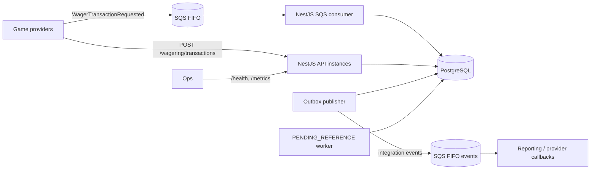
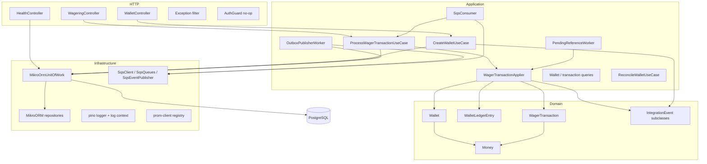
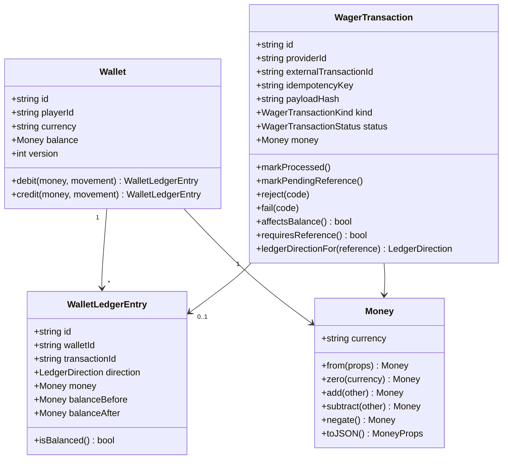
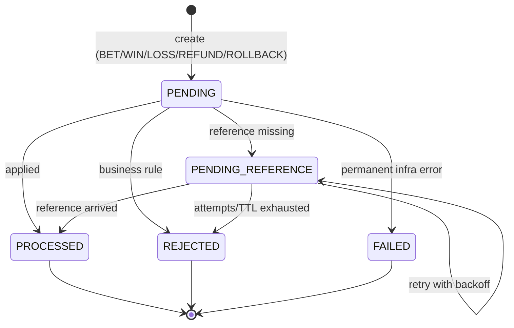
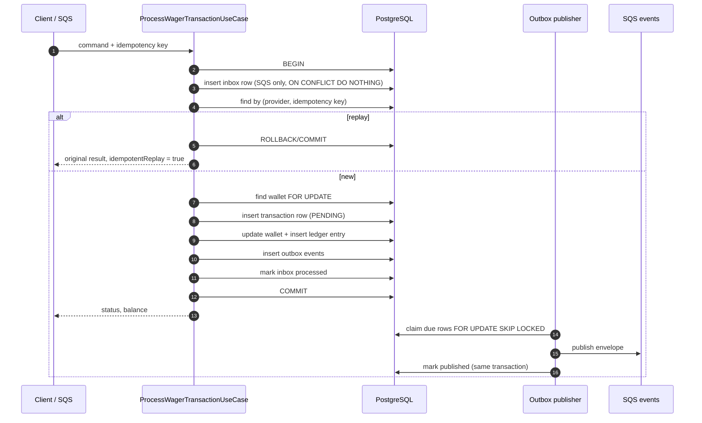
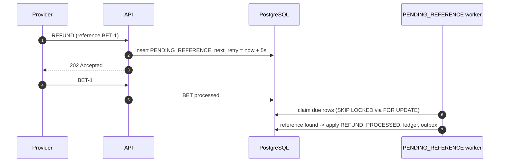

# Architecture — Distributed Wagering Processor

This document records the design decisions behind the service, the trade-offs
taken and what is intentionally out of scope. The setup and commands live in
[`README.md`](./README.md).

## 1. Goals

The service accepts wagering operations (`BET`, `WIN`, `LOSS`, `REFUND`,
`ROLLBACK`) from multiple game providers, keeps one wallet per
`playerId + currency`, and must stay correct when messages are duplicated,
delivered out of order, processed concurrently or when a process dies between
the database commit and the broker acknowledgement.

The invariants that drive every decision:

- no duplicated credit or debit;
- no negative balance, even under concurrent writes;
- every balance change has exactly one matching, immutable ledger entry;
- a confirmed event is never lost (transactional outbox);
- the result is correct with three or more application instances.

## 2. System context



The HTTP endpoint and the SQS consumer are two entry points to the **same**
application use case. The database is the only source of truth: broker features
(FIFO groups, deduplication ids) are treated as optimisations, never as the
guarantee.

## 3. Component view



Layer boundaries are enforced by folder structure and by dependency direction:
`domain` has no NestJS or ORM imports, `application` depends on ports and the
unit of work, `http`/`messaging` are adapters, `persistence` implements ports.

## 4. Stack decisions

| Decision | Choice | Why |
|---|---|---|
| ORM | **MikroORM 7** | Explicit unit of work and identity map, `LockMode.PESSIMISTIC_WRITE`, `EntityManager.transactional()`, versioned reversible migrations. Preferred by the challenge. |
| Money | **decimal.js** behind `Money` | Exact decimal arithmetic, fixed scale 2 on the wire; no `number`/`float` in the money path. |
| IDs | **UUIDv7** | Time-ordered, index friendly, stable cursor for the ledger. |
| Concurrency | **Pessimistic row lock per wallet** (`SELECT … FOR UPDATE`) + `version` + DB `CHECK` | Correct under contention without retry storms; the lock scope is one wallet, never global. |
| Messaging | **AWS SDK v3 SQS** directly | The FIFO queues, DLQ redrive and `ApproximateReceiveCount` are all we need; one less abstraction. |
| Local broker | **LocalStack 3.8** | Runs the real SQS API in Docker Compose. |
| Logs | **pino** (JSON) | Structured logs with request context and redaction. |
| Metrics | **prom-client** | `/metrics` in Prometheus format. |
| Validation | **zod** at the edges | Invalid payloads fail fast with field-level detail; domain rules stay in the domain. |
| Tests | **Bun test runner + Testcontainers** | Unit tests run with `bun test`; the Testcontainers e2e suite runs under Vitest because Bun 1.4.4 crashes loading Testcontainers' `ssh2` N-API module. Real PostgreSQL and real SQS, never mocked. |

### Why pessimistic locking

The unit of concurrency is the wallet. Every write path opens one SQL
transaction and loads the wallet with `SELECT … FOR UPDATE` before reading the
balance. Two bets on the same wallet therefore serialize at the row; bets on
different wallets run in parallel. This avoids the classic
`read → calculate → write` lost update without an optimistic retry loop, and it
makes the 80/80 race deterministic: the first transaction debits, the second
sees the new balance and rejects.

Optimistic locking with `version` alone was rejected as the primary mechanism
because hot wallets would produce frequent conflicts and retries. `version` is
still maintained and exposed: it is incremented only when the balance changes,
serves as an audit/optimistic token for consumers, and is asserted by tests.

`MikroOrmUnitOfWork` retries a whole transaction on `40001`
(serialization), `40P01` (deadlock) and `55P03` (lock not available) up to
three times, counting lock conflicts in a metric. `CHECK (balance >= 0)` in the
schema is the final safety net: even a bug in the application cannot persist a
negative balance.

## 5. Domain model



All aggregates have private constructors and static factories:
`create`/`open` validate and build new state, `rehydrate` only rebuilds
persisted state. `Wallet.debit`/`credit` return the ledger entry they produced,
so it is impossible to change the balance without producing the entry that
matches it. `WalletLedgerEntry` has no mutators and the database trigger blocks
`UPDATE`/`DELETE`.

### State machine



`PROCESSED`, `REJECTED` and `FAILED` are terminal; attempting a transition from
them throws `InvalidTransactionStateError` (a programming error, not a business
path). Business rejections are persisted rows with a `failureCode`, not thrown
exceptions.

## 6. Persistence and schema guarantees

Five tables: `wallets`, `wallet_ledger_entries`, `wager_transactions`,
`inbox_messages`, `outbox_messages`. Money is `numeric(20,2)` and is read back
as a decimal string; the currency is `char(3)`.

| Guarantee | Where |
|---|---|
| One wallet per player + currency | `UNIQUE (player_id, currency)` |
| Balance never negative | `CHECK (balance >= 0)` |
| Version starts at 1 | `CHECK (version >= 1)`, aggregate sets 1 |
| Currency shape | `CHECK (currency ~ '^[A-Z]{3}$')` |
| Ledger entry arithmetic | `CHECK (direction = 'DEBIT' AND before - amount = after OR direction = 'CREDIT' AND before + amount = after)` |
| Ledger balances non-negative | `CHECK (balance_before >= 0 AND balance_after >= 0)` |
| At most one entry per transaction | `UNIQUE (transaction_id)` |
| Ledger append-only | `BEFORE UPDATE OR DELETE` trigger raising an exception |
| Idempotency key uniqueness | `UNIQUE (provider_id, idempotency_key)` |
| External id uniqueness | `UNIQUE (provider_id, external_transaction_id)` |
| One reversal per reference and kind | partial `UNIQUE (reference_transaction_id, kind) WHERE status = 'PROCESSED'` |
| OPENING is internal | `CHECK (kind <> 'OPENING' OR origin = 'INTERNAL')` |
| REFUND/ROLLBACK require a reference | `CHECK (kind NOT IN ('REFUND','ROLLBACK') OR reference_external_transaction_id IS NOT NULL)` |
| No self reference | `CHECK (reference_external_transaction_id <> external_transaction_id)` |
| Rejection has a code | `CHECK (status NOT IN ('REJECTED','FAILED') OR failure_code IS NOT NULL)` |
| Inbox dedup | `UNIQUE (consumer_name, message_id)` |
| Outbox scan | partial index on `occurred_at WHERE published_at IS NULL` |
| Pending reference scan | partial index on `next_reference_retry_at WHERE status = 'PENDING_REFERENCE'` |

The migration is reversible (`down` drops the trigger, tables and types) and is
the only way the schema changes. The app never runs `schema:update`.

## 7. Money

`Money` is immutable and backed by `Decimal` (precision 40, no exponential
notation). Rules:

- input is a **string**; output is a **fixed-scale 2** string (`"25.00"`);
- `NaN`, `Infinity`, scientific notation, whitespace, empty strings, more than
  two decimals and negative input are rejected;
- negative values only exist as the result of arithmetic (`subtract`,
  `negate`), never as persisted contract input;
- operations across currencies throw `CurrencyMismatchError`.

The model is multi-currency, but this delivery accepts only `BRL` at the HTTP
edge (a zod literal), and the mismatch path is tested: a `USD` operation on a
`BRL` wallet is rejected with `CURRENCY_MISMATCH`.

## 8. Idempotency

`Idempotency-Key` is mandatory; the recommended value is
`{providerId}:{externalTransactionId}` and it is the source of truth.

`payloadHash` is `SHA-256` of a canonical JSON over business fields only:
`providerId`, `externalTransactionId`, `playerId`, `walletId`, `roundId`,
`gameId`, `kind`, `money` (normalized to scale 2) and
`referenceExternalTransactionId` (absent and `null` are equivalent). Keys are
sorted recursively; transport headers and metadata never participate. The
algorithm lives in `src/wagering/domain/canonical-payload.ts` and is pinned by
unit tests.

| Situation | Behaviour |
|---|---|
| Same key, same hash | Return the original result, `idempotentReplay: true` (HTTP 200, or the original status for a rejected transaction) |
| Same key, different hash | `409 IDEMPOTENCY_CONFLICT`, no state change |
| Different key, same external transaction id | `409 EXTERNAL_TRANSACTION_CONFLICT` |
| Two concurrent requests with the same key | One wins; the loser catches the unique violation, re-reads the winner inside a new transaction and replays it |

Idempotency is **persistent** (unique index on `provider_id, idempotency_key`);
there is no in-memory cache. Duplicated SQS deliveries are additionally
deduplicated by the inbox.

## 9. Processing pipeline



If the process dies after `COMMIT` and before the SQS `DeleteMessage`, the
message is redelivered; the inbox and the idempotency key both make the second
attempt a replay. If it dies after publishing but before marking the outbox row
published, the event is published again — at-least-once, and consumers must
deduplicate by `eventId`.

## 10. Concurrency

```mermaid
sequenceDiagram
    autonumber
    participant A as Instance A
    participant B as Instance B
    participant DB as PostgreSQL

    A->>DB: BEGIN; SELECT wallet FOR UPDATE
    B->>DB: BEGIN; SELECT wallet FOR UPDATE (waits)
    A->>DB: balance 100 - 80 = 20; INSERT ledger; UPDATE wallet; INSERT outbox
    A->>DB: COMMIT
    B->>DB: lock acquired; re-reads balance = 20
    B->>DB: 20 < 80 -> REJECTED (INSUFFICIENT_FUNDS); INSERT outbox; COMMIT
```

- The lock is per wallet, acquired inside the same transaction that writes.
- `LOSS` does not touch the wallet, so it does not take the lock and produces no
  ledger entry. A `LOSS` with a reference is accepted as provider metadata and
  does not resolve it.
- Wallets are independent: parallel processing of different wallets is the
  normal case.
- `SELECT … FOR UPDATE` on PostgreSQL uses `SKIP LOCKED` only in the outbox
  claim; wallet locks wait, which is what makes the loser observe the winner.
- Transactions retry on deadlock/serialization; a unique violation is resolved
  as an idempotent replay or a conflict, never as a silent success.

## 11. References and out-of-order delivery

`REFUND` and `ROLLBACK` require `referenceExternalTransactionId`; `WIN` may
optionally carry one. Any reference that is present is resolved by
`(providerId, referenceExternalTransactionId)` and must match the same provider,
player, wallet, currency, round and amount. `WIN` and `REFUND` reference only
`BET`; `ROLLBACK` references `BET`, `WIN` or `REFUND`; one reference can be
reversed once per operation kind (partial unique index). A `WIN` whose reference
has not arrived yet follows the same PENDING_REFERENCE policy, so an
out-of-order win is linked when the bet shows up instead of being silently
credited without a reference.

When the reference is missing (or not yet processed), the transaction is
persisted as `PENDING_REFERENCE` and the worker retries with exponential
backoff: **5s, 15s, 45s, 2m, 5m**, at most **5 attempts** and a **15-minute
TTL** from creation. The TTL wins over the attempt count and is reported as
`REFERENCE_EXPIRED`; exhausting attempts first is `REFERENCE_NOT_FOUND`. Both
are terminal `REJECTED` rows with a corresponding `WagerTransactionRejected`
event.



The worker processes each row in its own transaction and re-locks the row, so
multiple workers can run concurrently without double-applying. Retries and the
final rejection both go through the same `WagerTransactionApplier` used by the
ingress path.

## 12. Transactional outbox

The transaction row, wallet change, ledger entry, inbox row and outbox rows are
committed in **one** SQL transaction. Publishing never happens before commit.

The publisher claims a batch with `FOR UPDATE SKIP LOCKED` inside its own
transaction, publishes the events and marks the rows published before
committing. Events are grouped by `aggregateId`: within a group the order is
preserved, while different groups are published concurrently (bounded by
`OUTBOX_PUBLISH_CONCURRENCY`), which is what lets a single instance keep up with
a burst of transactions. Multiple publishers can run; each row is claimed by
one at a time.
A crash after publish and before commit republishes; a crash after commit
before publish leaves the row pending for the next instance. This is
at-least-once, which is why every event has an `eventId` and consumers
deduplicate.

Events (`IntegrationEvent` subclasses, `eventType` and `version` in the type):

| Event | When |
|---|---|
| `WagerTransactionProcessed` | any applied transaction, including `LOSS` |
| `WagerTransactionRejected` | business rejection, including exhausted references |
| `WalletBalanceChanged` | only when the balance changes |
| `WagerTransactionPendingReference` | a reference is still missing |

```mermaid
sequenceDiagram
    autonumber
    participant DB as PostgreSQL
    participant P1 as Publisher 1
    participant P2 as Publisher 2
    participant Q as SQS events

    P1->>DB: BEGIN; SELECT ... FOR UPDATE SKIP LOCKED
    P2->>DB: BEGIN; SELECT ... FOR UPDATE SKIP LOCKED (skips P1 rows)
    P1->>Q: publish event A
    P1->>DB: mark A published; COMMIT
    P2->>Q: publish event B
    P2->>DB: mark B published; COMMIT
```

The outbound events go to `wager-events.fifo`, a separate FIFO queue. SQS has
no fan-out, so publishing them to the request queue would make the request
consumer read (and dead-letter) its own events. In a production topology this
would be SNS/EventBridge with SQS subscribers; the separate queue is the
smallest equivalent that keeps the request path clean.

## 13. Inbox and SQS consumer

- `wager-transactions.fifo` receives `WagerTransactionRequested` envelopes;
  `wager-transactions-dlq.fifo` receives permanent failures.
- The consumer reuses `ProcessWagerTransactionUseCase`, so HTTP and SQS share
  validation, idempotency and business rules.
- Deduplication uses the persistent inbox `(consumer_name, message_id)` with
  `ON CONFLICT DO NOTHING`; the inbox insert is part of the financial
  transaction.
- `DeleteMessage` (ack) happens **only after** the SQL transaction commits.
- Failure classes:
  - **business** (insufficient funds, already reversed, reference mismatch…):
    returned as `REJECTED`, persisted and acked;
  - **transient** (database/broker unavailable): the message is left for
    redelivery after the visibility timeout, up to `SQS_MAX_ATTEMPTS`;
  - **permanent** (invalid payload, idempotency conflict, external id conflict,
    unknown wallet): moved to the DLQ explicitly, then acked.
- On `SIGTERM`, the receive loop stops, in-flight messages finish (bounded by
  `SHUTDOWN_GRACE_MS`) and anything unfinished returns to the queue with the
  visibility timeout.

## 14. HTTP API

| Endpoint | Purpose |
|---|---|
| `POST /wallets` | create a wallet (optional initial balance creates an internal `OPENING`) |
| `GET /wallets/:walletId` | balance and version |
| `GET /wallets/:walletId/ledger?cursor=&limit=` | stable, opaque cursor pagination over the ledger |
| `POST /wallets/:walletId/reconciliation` | compares stored balance with the ledger sum |
| `POST /wagering/transactions` | submit an operation (`Idempotency-Key` required) |
| `GET /wagering/transactions/:transactionId` | transaction by internal id |
| `GET /providers/:providerId/wagering/transactions/:externalTransactionId` | transaction by provider id |
| `GET /health/live`, `GET /health/ready` | liveness; readiness checks PostgreSQL and SQS |
| `GET /metrics` | Prometheus metrics |

Status mapping (consistent across endpoints):

| Status | Meaning |
|---|---|
| `201 Created` | transaction processed (or wallet created) |
| `200 OK` | idempotent replay, or successful query/reconciliation |
| `202 Accepted` | accepted but waiting for a reference (`PENDING_REFERENCE`) |
| `400 Bad Request` | invalid payload/validation (`INVALID_PAYLOAD`) |
| `404 Not Found` | wallet/transaction does not exist |
| `409 Conflict` | idempotency conflict, external id conflict, duplicate wallet |
| `422 Unprocessable Entity` | business rejection with a `failureCode` |
| `503 Service Unavailable` | transient infrastructure failure (connection-level SQLSTATEs such as `08xxx`, `57P03`, `53300`, and socket errors like `ECONNREFUSED`/`ETIMEDOUT`) |
| `500 Internal Server Error` | unexpected programming error |

Business rejections are `422` and carry the stable `failureCode`, so a provider
can distinguish "retry later" (`503`), "fix the payload" (`400`/`409`), "do not
retry" (`422`) and "already accepted, wait" (`202`).

## 15. Failure taxonomy

`failureCode` is a closed enum, part of the public contract; values are never
renamed, only added.

| Code | Situation | Provider action |
|---|---|---|
| `INSUFFICIENT_FUNDS` | bet/debit larger than the balance | do not retry |
| `REVERSAL_INSUFFICIENT_FUNDS` | rollback would take the wallet below zero (distinct from a normal bet) | inspect, do not blind retry |
| `CURRENCY_MISMATCH` | operation currency differs from the wallet | fix payload |
| `WALLET_NOT_FOUND` | wallet id does not exist (HTTP 404) | fix payload |
| `PLAYER_WALLET_MISMATCH` | wallet belongs to another player | fix payload |
| `REFERENCE_REQUIRED` | REFUND/ROLLBACK without a reference | fix payload |
| `REFERENCE_NOT_FOUND` | reference never arrived (attempts exhausted) | do not retry |
| `REFERENCE_EXPIRED` | reference arrived after the TTL | do not retry |
| `REFERENCE_NOT_PROCESSED` | reference exists but is pending/rejected | do not retry |
| `REFERENCE_NOT_SUCCESSFUL` | reference was rejected/failed | do not retry |
| `INVALID_REFERENCE_KIND` | REFUND→not BET, ROLLBACK→not reversible | fix payload |
| `REFERENCE_MISMATCH` | different provider/player/wallet/currency/round | fix payload |
| `AMOUNT_MISMATCH` | refund/rollback amount differs from the reference | fix payload |
| `ALREADY_REVERSED` | reference already reverted by the same kind | do not retry |
| `UNSUPPORTED_KIND` | OPENING or unknown kind from external ingress | fix payload |
| `INVALID_AMOUNT` | non-positive/invalid amount | fix payload |
| `INVALID_REFERENCE` | malformed/self reference | fix payload |
| `INFRA_PERMANENT_FAILURE` | permanent infrastructure failure after persistence | contact support |

## 16. Observability

- **Structured JSON logs** through pino with `correlationId`, `messageId`,
  `transactionId`, `walletId`, `providerId`, HTTP method/path/status/duration
  and worker names. Authorization headers, cookies and money fields are
  redacted; full financial payloads are never logged.
- **Metrics** at `/metrics`: transactions by status/kind, processing latency,
  idempotent replays, idempotency conflicts, inbox duplicates, SQS retries, DLQ
  messages, lock conflicts, outbox published/failures/pending/lag,
  PENDING_REFERENCE gauge, reconciliation mismatches, wallets created, plus
  Node defaults.
- **Health**: `/health/live` is process-only; `/health/ready` pings PostgreSQL
  and SQS and returns `503` when either is down. Both are public.
- Reconciliation never fixes divergences silently: it logs an error, increments
  `reconciliation_mismatch_total` and returns `consistent: false` with the
  difference.

## 17. Authentication — decision and extension point

Authentication is **not implemented**, as allowed by the challenge. The
decision and the design that would be adopted are documented here, and the
extension point is explicit in code:

- `AuthGuard` is a global `CanActivate` that allows every request today;
- `ProviderIdentityPort` (`src/auth/auth.guard.ts`) is the seam: an adapter
  resolves the caller identity from the request and reports `enabled = true`;
- `@Public()` marks the endpoints that must stay open (health, metrics);
- the provider id contained in a message is still validated by the domain,
  independently of transport authentication.

Production design: **Keycloak** as OIDC provider (client credentials for
providers, authorization code for operators). The adapter would validate the
JWT signature against the realm JWKS, check `exp`/`iss`/`aud`, map the token to
`ProviderIdentity { providerId, subject, scopes }` and reject requests whose
`providerId` body field does not match the token claim. SQS messages are an
internal trusted channel; their `providerId` still goes through the same domain
checks.

## 18. Testing strategy

Unit (`bun run test`, executed by Bun's test runner):

- `Money`: scale, serialization, invalid inputs (NaN, Infinity, exponent,
  whitespace, >2 decimals, negative), the `numeric(20,2)` upper bound,
  immutability, exact accumulation, currency mismatch;
- `Wallet`: opening invariants, debit/credit arithmetic, version increment,
  insufficient funds, zero/negative movements, rehydration;
- `WagerTransaction`: reference requirements, internal-only OPENING, terminal
  transitions, failure codes, `affectsBalance`, rollback direction,
  payload matching;
- canonical payload: key sorting, scale normalization, absent reference,
  field-by-field hash sensitivity;
- command parsing: mandatory/oversized idempotency key, invalid payloads,
  external `OPENING`, SQS envelope shape;
- HTTP filter mapping (404/409/503/500) and transient database error
  classification.

Integration and concurrency (`bun run test:e2e`, real PostgreSQL and LocalStack
via Testcontainers):

- migrations and schema constraints (negative balance, ledger immutability,
  duplicate wallet, duplicate reversal, external OPENING);
- atomicity of wallet + OPENING + ledger + outbox (two concurrent creates);
- inbox redelivery and duplicate business payloads;
- idempotent replay, rejected replay, payload conflict, external id conflict;
- 50 parallel identical bets → one debit;
- 80/80 race → one processed, one rejected, balance 20, one debit;
- distinct wallets in parallel;
- three application instances sharing the database;
- refund before the bet, retry exhaustion and `REFERENCE_EXPIRED`;
- amount mismatch and double reversal;
- outbox atomicity, two publishers racing, publish after a simulated restart;
- inbox rollback when the financial transaction fails;
- SQS consumer: valid message processed, redelivery deduplicated, invalid
  payload and unknown wallet routed to the DLQ, and transient failures
  redelivered until the attempt limit before the DLQ;
- ledger cursor pagination;
- every scenario asserts `wallet.balance == ledger sum` (reconciliation).

The Docker Compose stack was also validated manually with three app replicas
behind nginx: six simultaneous 80.00 bets against a 100.00 wallet produced
exactly one `PROCESSED`, five `REJECTED`, balance 20.00 and one debit entry.

`bun run test:load` is an optional experiment (not part of the test gate) that
drives a mixed workload against the Compose deployment and reports throughput,
latency percentiles, status distribution and a final reconciliation. The
recorded run, its environment and the outbox backlog analysis are in
`README.md`.

## 19. Trade-offs and limitations

- **Pessimistic locking** serializes writes per wallet; a very hot wallet can
  become a throughput bottleneck. Sharding by wallet or batching would be the
  next step; correctness was prioritised.
- **FIFO queues** give ordering per `MessageGroupId` (the wallet id), but the
  database remains the guarantee; the system does not rely on FIFO for
  correctness.
- **Outbox publishing inside the claim transaction** holds row locks while
  calling SQS. A slow broker delays other publishers for the same rows, but
  never blocks writers (the outbox is append-only) and never loses events.
  Under a sustained burst of ~250 transactions/s (≈500 events/s) the local
  LocalStack broker cannot keep up: the backlog reached ~9 s of lag and drained
  to zero within 30 s after the burst. See the load experiment in `README.md`.
- **Cross-aggregate event ordering is not guaranteed** (neither by SQS FIFO,
  whose ordering is per `MessageGroupId`, nor by concurrent publishers).
  Consumers correlate through `transactionId`/`causationId` and deduplicate by
  `eventId`.
- **At-least-once everywhere**: duplicate events are possible after a crash;
  consumers must deduplicate by `eventId`. Duplicate SQS deliveries are
  deduplicated by the inbox.
- **Single currency at the edge**: the model and validations are multi-currency
  but the API accepts only `BRL`, as allowed by the challenge.
- **No authentication**; see section 17.
- **No load test** (`bun run test:load`) is included; the concurrency suite
  covers correctness under parallelism, not throughput.
- **`FAILED`** is modelled and persisted but the current ingestion paths only
  produce `PROCESSED`, `PENDING_REFERENCE` and `REJECTED`; `FAILED` is reserved
  for a permanent infrastructure error after the row exists (for example a
  poison event that cannot be serialized), and is documented for completeness.
- The ledger is single-entry per wallet (the wallet is the counterparty); full
  double-entry bookkeeping was optional and is not implemented.
- `OPENING` is created only by wallet creation and does not increment `version`
  (the initial balance is part of creation, not a later change).

## 20. Repository map

```
src/
  auth/            no-op guard + ProviderIdentityPort (extension point)
  config/          env parsing (zod), DI tokens
  database/        migration CLI
  health/          liveness, readiness, /metrics
  messaging/
    domain/        inbox, outbox, integration events
    persistence/   rows and repositories
    sqs/           client, queues, publisher, consumer
    outbox/        publisher worker
    workers/       periodic worker, PENDING_REFERENCE worker
  migrations/      initial reversible migration
  platform/        database (UoW, MikroORM), http, logging, metrics, errors
  shared/          Money, clock, id generator, domain errors
  wagering/        domain, application, persistence, http
  wallets/         domain, application, persistence, http
test/              Testcontainers harness + e2e suite
docker/            LocalStack queue bootstrap, nginx config
```
