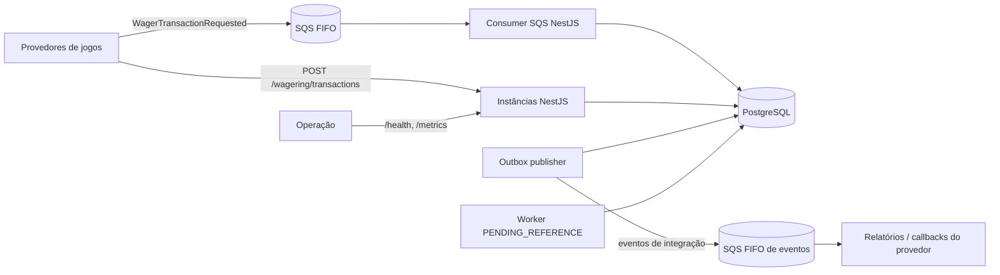
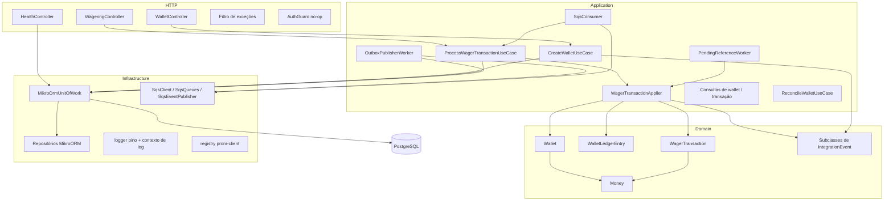
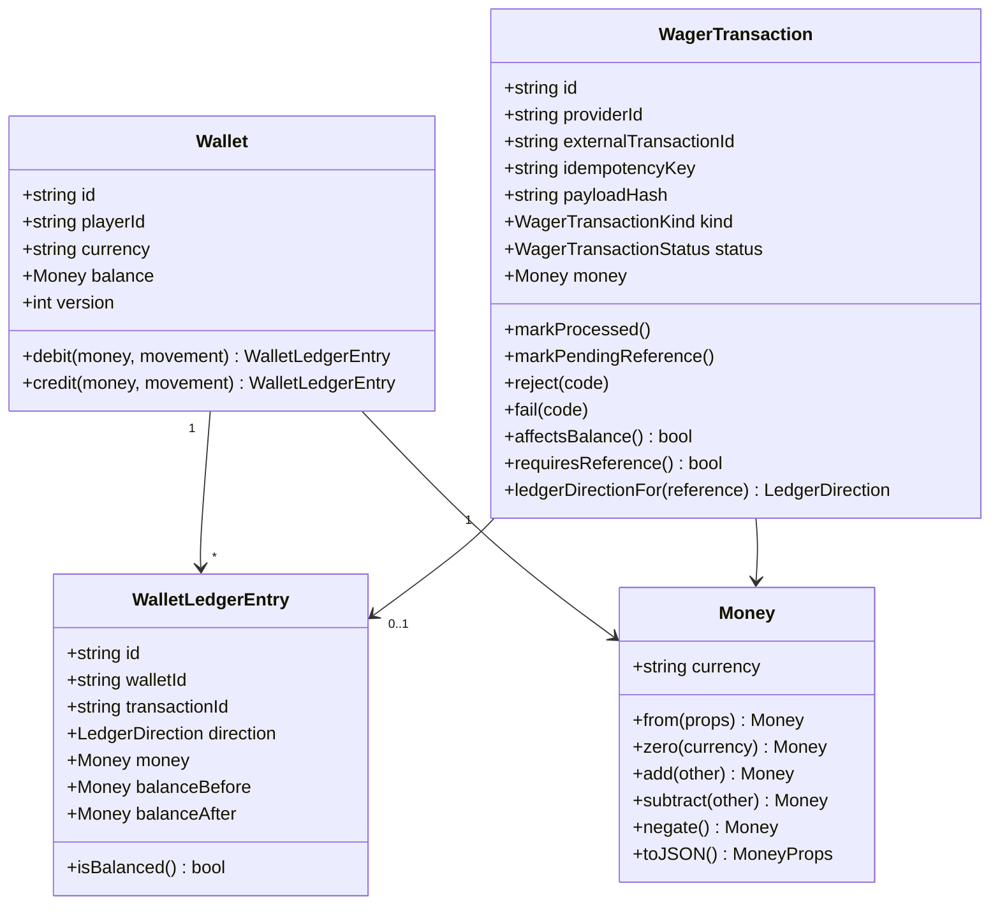
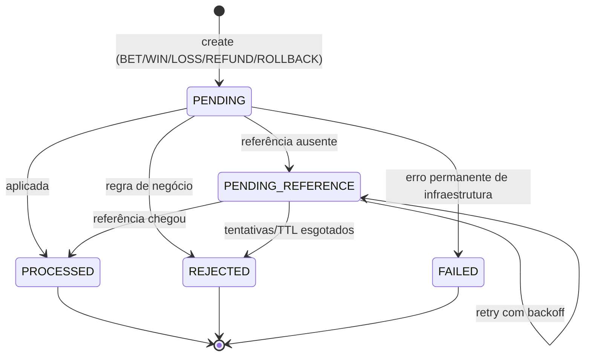
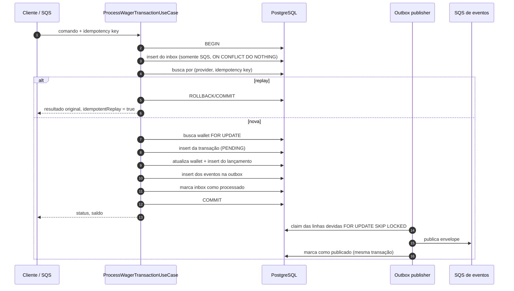
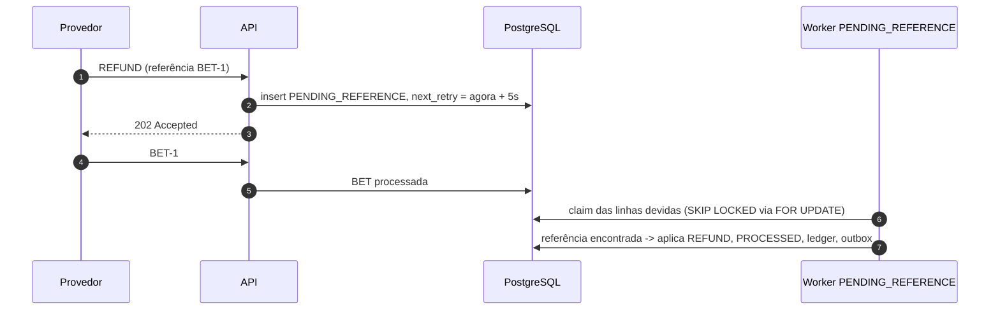

# Arquitetura — Distributed Wagering Processor

Este documento registra as decisões de projeto do serviço, os trade-offs
assumidos e o que está intencionalmente fora de escopo. O setup e os comandos
estão no [`README.md`](./README.md).

## 1. Objetivos

O serviço aceita operações de apostas (`BET`, `WIN`, `LOSS`, `REFUND`,
`ROLLBACK`) de múltiplos provedores de jogos, mantém uma wallet por
`playerId + currency` e precisa continuar correto quando mensagens são
duplicadas, entregues fora de ordem, processadas concorrentemente ou quando um
processo morre entre o commit do banco e o acknowledgement do broker.

As invariantes que guiam todas as decisões:

- nenhum crédito ou débito duplicado;
- saldo nunca negativo, mesmo sob escritas concorrentes;
- toda alteração de saldo tem exatamente um lançamento imutável correspondente
  no ledger;
- um evento confirmado nunca é perdido (transactional outbox);
- o resultado é correto com três ou mais instâncias da aplicação.

## 2. Contexto do sistema



O endpoint HTTP e o consumer SQS são duas entradas para o **mesmo** caso de uso
da aplicação. O banco é a única fonte da verdade: recursos do broker (grupos
FIFO, ids de deduplicação) são tratados como otimização, nunca como a garantia.

## 3. Visão de componentes



Os limites de camada são garantidos pela estrutura de pastas e pela direção das
dependências: `domain` não importa NestJS nem ORM, `application` depende de
portas e do unit of work, `http`/`messaging` são adaptadores e `persistence`
implementa as portas.

## 4. Decisões de stack

| Decisão | Escolha | Por quê |
|---|---|---|
| ORM | **MikroORM 7** | Unit of work e identity map explícitos, `LockMode.PESSIMISTIC_WRITE`, `EntityManager.transactional()` e migrations versionadas reversíveis. É o preferencial do desafio. |
| Dinheiro | **decimal.js** atrás de `Money` | Aritmética decimal exata e escala fixa 2 no contrato; nenhum `number`/`float` no caminho do dinheiro. |
| Ids | **UUIDv7** | Ordenados no tempo, amigáveis a índice B-tree e com cursor estável para o ledger. |
| Concorrência | **Lock pessimista por wallet** (`SELECT … FOR UPDATE`) + `version` + `CHECK` no banco | Correto sob contenção sem tempestade de retries; o escopo do lock é uma wallet, nunca global. |
| Mensageria | **AWS SDK v3 SQS** direto | As filas FIFO, o redrive da DLQ e o `ApproximateReceiveCount` são tudo de que precisamos; uma abstração a menos. |
| Broker local | **LocalStack 3.8** | Executa a API real do SQS no Docker Compose. |
| Logs | **pino** (JSON) | Logs estruturados com contexto de requisição e redaction. |
| Métricas | **prom-client** | `/metrics` no formato Prometheus. |
| Validação | **zod** nas bordas | Payloads inválidos falham cedo com detalhe por campo; regras de domínio ficam no domínio. |
| Testes | **runner do Bun + Testcontainers** | As duas suítes rodam com `bun test`; PostgreSQL e SQS reais, nunca mocks. |

### Por que lock pessimista

A unidade de concorrência é a wallet. Todo caminho de escrita abre uma transação
SQL e carrega a wallet com `SELECT … FOR UPDATE` antes de ler o saldo. Duas
apostas na mesma wallet, portanto, serializam na linha; apostas em wallets
diferentes rodam em paralelo. Isso evita o clássico lost update de
`ler → calcular → escrever` sem um laço de retry otimista e torna a corrida
80/80 determinística: a primeira transação debita, a segunda vê o novo saldo e
rejeita.

Lock otimista apenas com `version` foi descartado como mecanismo principal
porque wallets quentes gerariam conflitos e retries frequentes. `version`
continua sendo mantida e exposta: incrementa apenas quando o saldo muda, serve
como token de auditoria/otimista para consumidores e é verificada nos testes.

`MikroOrmUnitOfWork` repete a transação inteira em `40001` (serialização),
`40P01` (deadlock) e `55P03` (lock indisponível) por até três tentativas,
contabilizando conflitos de lock em métrica. O `CHECK (balance >= 0)` no schema
é a rede de segurança final: nem um bug na aplicação consegue persistir saldo
negativo.

### Por que os imports usam `.js`

O projeto é ESM (`"type": "module"`) e compila com `module`/`moduleResolution:
nodenext`. Nesse modo o Node exige extensão explícita em imports relativos: o
arquivo emitido é `dist/foo.js`, então o import no fonte precisa ser `./foo.js`
mesmo que o arquivo seja `foo.ts`. O TypeScript resolve `./foo.js` para
`foo.ts` na compilação e preserva o caminho no output. É o padrão recomendado
para ESM + Node e também funciona no Bun.

Remover as extensões exigiria CommonJS (`module: commonjs`, `"type":
"commonjs"`) ou um bundler. Isso foi descartado porque `uuid` v14 é ESM-only, o
runtime alvo é Bun/Node ESM e o `nodenext` também valida corretamente as
condições de exportação dos pacotes. A extensão `.js`, portanto, é intencional.

## 5. Modelo de domínio



Todos os agregados têm construtor privado e factories estáticas:
`create`/`open` validam e constroem estado novo, `rehydrate` apenas reconstrói
estado persistido. `Wallet.debit`/`credit` devolvem o lançamento que produziram,
então é impossível alterar o saldo sem produzir o lançamento correspondente.
`WalletLedgerEntry` não tem mutadores e o trigger do banco bloqueia
`UPDATE`/`DELETE`.

### Máquina de estados



`PROCESSED`, `REJECTED` e `FAILED` são terminais; tentar transicionar a partir
deles lança `InvalidTransactionStateError` (erro de programação, não caminho de
negócio). Rejeições de negócio são linhas persistidas com `failureCode`, não
exceções lançadas.

## 6. Persistência e garantias do schema

Cinco tabelas: `wallets`, `wallet_ledger_entries`, `wager_transactions`,
`inbox_messages` e `outbox_messages`. Dinheiro é `numeric(20,2)`, lido de volta
como string decimal; a moeda é `char(3)`.

| Garantia | Onde |
|---|---|
| Uma wallet por player + moeda | `UNIQUE (player_id, currency)` |
| Saldo nunca negativo | `CHECK (balance >= 0)` |
| Version começa em 1 | `CHECK (version >= 1)`, agregado define 1 |
| Formato da moeda | `CHECK (currency ~ '^[A-Z]{3}$')` |
| Aritmética do lançamento | `CHECK (direction = 'DEBIT' AND before - amount = after OR direction = 'CREDIT' AND before + amount = after)` |
| Saldos do ledger não negativos | `CHECK (balance_before >= 0 AND balance_after >= 0)` |
| No máximo um lançamento por transação | `UNIQUE (transaction_id)` |
| Ledger append-only | trigger `BEFORE UPDATE OR DELETE` que lança exceção |
| Unicidade da idempotency key | `UNIQUE (provider_id, idempotency_key)` |
| Unicidade do id externo | `UNIQUE (provider_id, external_transaction_id)` |
| Uma reversão por referência e tipo | `UNIQUE (reference_transaction_id, kind) WHERE status = 'PROCESSED'` parcial |
| OPENING é interno | `CHECK (kind <> 'OPENING' OR origin = 'INTERNAL')` |
| REFUND/ROLLBACK exigem referência | `CHECK (kind NOT IN ('REFUND','ROLLBACK') OR reference_external_transaction_id IS NOT NULL OR status = 'REJECTED')` (a ausência de referência é, ela própria, uma rejeição persistida) |
| Sem auto-referência | `CHECK (reference_external_transaction_id <> external_transaction_id)` |
| Rejeição tem código | `CHECK (status NOT IN ('REJECTED','FAILED') OR failure_code IS NOT NULL)` |
| Dedup do inbox | `UNIQUE (consumer_name, message_id)` |
| Varredura da outbox | índice parcial em `occurred_at WHERE published_at IS NULL` |
| Varredura de referências pendentes | índice parcial em `next_reference_retry_at WHERE status = 'PENDING_REFERENCE'` |

A migration é reversível (`down` remove trigger, tabelas e tipos) e é a única
forma de o schema mudar. A aplicação nunca executa `schema:update`.

## 7. Dinheiro

`Money` é imutável e usa `Decimal` (precisão 40, sem notação exponencial).
Regras:

- a entrada é **string**; a saída é string com **escala fixa 2** (`"25.00"`);
- `NaN`, `Infinity`, notação científica, espaços, string vazia, mais de duas
  casas decimais e entrada negativa são rejeitados;
- valores negativos só existem como resultado de aritmética (`subtract`,
  `negate`), nunca como entrada de contrato persistida;
- operações entre moedas diferentes lançam `CurrencyMismatchError`;
- valores acima do limite de `numeric(20,2)` são rejeitados como validação.

O modelo é multi-moeda, mas esta entrega aceita apenas `BRL` na borda HTTP (um
literal do zod), e o caminho de conflito é testado: uma operação em `USD` sobre
uma wallet `BRL` é rejeitada com `CURRENCY_MISMATCH`.

## 8. Idempotência

`Idempotency-Key` é obrigatório; o valor recomendado é
`{providerId}:{externalTransactionId}` e ele é a fonte da verdade.

`payloadHash` é o `SHA-256` de um JSON canônico apenas com campos de negócio:
`providerId`, `externalTransactionId`, `playerId`, `walletId`, `roundId`,
`gameId`, `kind`, `money` (normalizada para escala 2) e
`referenceExternalTransactionId` (ausente e `null` são equivalentes). As chaves
são ordenadas recursivamente; headers e metadados de transporte nunca
participam. O algoritmo fica em
`src/wagering/domain/canonical-payload.ts` e é fixado por testes unitários.

| Situação | Comportamento |
|---|---|
| Mesma chave, mesmo hash | Retorna o resultado original, `idempotentReplay: true` (HTTP 200, ou o status original no caso de transação rejeitada) |
| Mesma chave, hash diferente | `409 IDEMPOTENCY_CONFLICT`, sem mudança de estado |
| Chave diferente, mesmo id externo | `409 EXTERNAL_TRANSACTION_CONFLICT` |
| Duas requisições concorrentes com a mesma chave | Uma vence; a perdedora captura a violação de unicidade, relê a vencedora em uma nova transação e faz replay |

A idempotência é **persistente** (índice único em `provider_id,
idempotency_key`); não existe cache em memória. Entregas duplicadas de SQS são
adicionalmente deduplicadas pelo inbox.

Na resolução da corrida, a linha encontrada pelo id externo também é inspecionada:
se ela carrega a mesma idempotency key, é a mesma requisição e a resposta é
replay. Isso evita um falso `409` quando a primeira consulta não enxerga a linha
recém-commitada da vencedora.

## 9. Pipeline de processamento



Se o processo morre depois do `COMMIT` e antes do `DeleteMessage` do SQS, a
mensagem é reentregue; o inbox e a idempotency key fazem a segunda tentativa ser
um replay. Se morre depois de publicar e antes de marcar a linha da outbox como
publicada, o evento é publicado de novo — at-least-once, e consumidores devem
deduplicar por `eventId`.

## 10. Concorrência

```mermaid
sequenceDiagram
    autonumber
    participant A as Instância A
    participant B as Instância B
    participant DB as PostgreSQL

    A->>DB: BEGIN; SELECT wallet FOR UPDATE
    B->>DB: BEGIN; SELECT wallet FOR UPDATE (aguarda)
    A->>DB: saldo 100 - 80 = 20; INSERT ledger; UPDATE wallet; INSERT outbox
    A->>DB: COMMIT
    B->>DB: lock adquirido; relê saldo = 20
    B->>DB: 20 < 80 -> REJECTED (INSUFFICIENT_FUNDS); INSERT outbox; COMMIT
```

- O lock é por wallet, adquirido dentro da mesma transação que escreve.
- `LOSS` não toca na wallet, então não pega o lock e não produz lançamento. Um
  `LOSS` com referência é aceito como metadado do provedor e não a resolve.
- Wallets são independentes: processar wallets diferentes em paralelo é o caso
  normal.
- `SELECT … FOR UPDATE` no PostgreSQL usa `SKIP LOCKED` apenas no claim da
  outbox; locks de wallet esperam, o que faz a perdedora observar a vencedora.
- Transações são repetidas em deadlock/serialização; violação de unicidade é
  resolvida como replay idempotente ou conflito, nunca como sucesso silencioso.

## 11. Referências e entrega fora de ordem

`REFUND` e `ROLLBACK` exigem `referenceExternalTransactionId`; `WIN` pode
opcionalmente carregar uma. Toda referência presente é resolvida por
`(providerId, referenceExternalTransactionId)` e precisa pertencer ao mesmo
provider, player, wallet, moeda, rodada e valor. `WIN` e `REFUND` referenciam
apenas `BET`; `ROLLBACK` referencia `BET`, `WIN` ou `REFUND`; uma referência pode
ser revertida uma vez por tipo de operação (índice único parcial). Um `WIN` cuja
referência ainda não chegou segue a mesma política de `PENDING_REFERENCE`, então
um win fora de ordem é vinculado quando a bet aparece, em vez de ser creditado
sem referência.

Quando a referência está ausente (ou ainda não foi processada), a transação é
persistida como `PENDING_REFERENCE` e o worker tenta novamente com backoff
exponencial: **5s, 15s, 45s, 2m, 5m**, no máximo **5 tentativas** e **TTL de 15
minutos** a partir da criação. Os valores são configuráveis
(`PENDING_REFERENCE_MAX_ATTEMPTS`, `PENDING_REFERENCE_TTL_MINUTES`) e foram
escolhidos para cobrir um provedor lento sem manter transação aberta nem
dinheiro parado indefinidamente: a janela de backoff é de ~7,5 minutos e o TTL
de 15 minutos limita o pior caso. O TTL vence a contagem de tentativas e é
reportado como `REFERENCE_EXPIRED`; esgotar as tentativas primeiro é
`REFERENCE_NOT_FOUND`. Ambos são linhas terminais `REJECTED` com o evento
`WagerTransactionRejected` correspondente.



O worker processa cada linha na própria transação e re-trava a linha, então
vários workers podem rodar concorrentemente sem aplicar duas vezes. Retries e a
rejeição final passam pelo mesmo `WagerTransactionApplier` usado no caminho de
ingresso.

## 12. Transactional outbox

A linha da transação, a alteração de saldo, o lançamento no ledger, a linha do
inbox e as linhas da outbox são commitados em **uma** transação SQL. A
publicação nunca acontece antes do commit.

O publisher faz o claim de um lote com `FOR UPDATE SKIP LOCKED` na própria
transação, publica os eventos e marca as linhas como publicadas antes de
commitar. Os eventos são agrupados por `aggregateId`: dentro do grupo a ordem é
preservada, enquanto grupos diferentes são publicados em paralelo (limitado por
`OUTBOX_PUBLISH_CONCURRENCY`), o que permite a uma instância acompanhar um burst
de transações. Vários publishers podem rodar; cada linha é reivindicada por um
de cada vez.

Um crash depois de publicar e antes do commit republica; um crash depois do
commit e antes de publicar deixa a linha pendente para a próxima instância. Isso
é at-least-once, e por isso todo evento tem `eventId` e consumidores deduplicam.

Eventos (subclasses de `IntegrationEvent`, com `eventType` e `version` no tipo):

| Evento | Quando |
|---|---|
| `WagerTransactionProcessed` | qualquer transação aplicada, inclusive `LOSS` |
| `WagerTransactionRejected` | rejeição de negócio, incluindo referências esgotadas |
| `WalletBalanceChanged` | somente quando o saldo muda |
| `WagerTransactionPendingReference` | referência ainda ausente |

```mermaid
sequenceDiagram
    autonumber
    participant DB as PostgreSQL
    participant P1 as Publisher 1
    participant P2 as Publisher 2
    participant Q as SQS de eventos

    P1->>DB: BEGIN; SELECT ... FOR UPDATE SKIP LOCKED
    P2->>DB: BEGIN; SELECT ... FOR UPDATE SKIP LOCKED (ignora linhas da P1)
    P1->>Q: publica evento A
    P1->>DB: marca A como publicado; COMMIT
    P2->>Q: publica evento B
    P2->>DB: marca B como publicado; COMMIT
```

Os eventos de saída vão para `wager-events.fifo`, uma fila FIFO separada. O SQS
não tem fan-out, então publicá-los na fila de requisições faria o consumer de
requisições ler (e mandar para a DLQ) os próprios eventos. Em uma topologia de
produção isso seria SNS/EventBridge com subscribers SQS; a fila separada é o
equivalente mínimo que mantém o caminho de requisições limpo.

## 13. Inbox e consumer SQS

- `wager-transactions.fifo` recebe envelopes `WagerTransactionRequested`;
  `wager-transactions-dlq.fifo` recebe falhas permanentes.
- O consumer reutiliza `ProcessWagerTransactionUseCase`, então HTTP e SQS
  compartilham validação, idempotência e regras de negócio.
- A deduplicação usa o inbox persistente `(consumer_name, message_id)` com
  `ON CONFLICT DO NOTHING`; o insert do inbox faz parte da transação financeira.
  O SQL bruto é executado com o contexto transacional do EntityManager — sem
  isso, ele pegaria outra conexão do pool e escaparia da transação.
- `DeleteMessage` (ack) acontece **somente depois** do commit da transação SQL.
- Classes de falha:
  - **negócio** (saldo insuficiente, já revertida, referência divergente…):
    retornada como `REJECTED`, persistida e ackada;
  - **transitória** (banco/broker indisponível): a mensagem fica para
    reentrega após o visibility timeout, até `SQS_MAX_ATTEMPTS`;
  - **permanente** (payload inválido, conflito de idempotência, conflito de id
    externo, wallet desconhecida): movida explicitamente para a DLQ e ackada.
- Em `SIGTERM`, o laço de recebimento para, mensagens em andamento terminam
  (limitadas por `SHUTDOWN_GRACE_MS`) e o que não terminar volta para a fila
  pelo visibility timeout.

## 14. API HTTP

| Endpoint | Finalidade |
|---|---|
| `POST /wallets` | cria wallet (saldo inicial opcional gera um `OPENING` interno) |
| `GET /wallets/:walletId` | saldo e version |
| `GET /wallets/:walletId/ledger?cursor=&limit=` | paginação estável e opaca do ledger |
| `POST /wallets/:walletId/reconciliation` | compara saldo armazenado com a soma do ledger |
| `POST /wagering/transactions` | submete uma operação (`Idempotency-Key` obrigatório) |
| `GET /wagering/transactions/:transactionId` | transação por id interno |
| `GET /providers/:providerId/wagering/transactions/:externalTransactionId` | transação por id do provedor |
| `GET /health/live`, `GET /health/ready` | liveness; readiness verifica PostgreSQL e SQS |
| `GET /metrics` | métricas Prometheus |

Mapeamento de status (consistente entre os endpoints):

| Status | Significado |
|---|---|
| `201 Created` | transação processada (ou wallet criada) |
| `200 OK` | replay idempotente, ou consulta/reconciliação bem-sucedida |
| `202 Accepted` | aceita, aguardando referência (`PENDING_REFERENCE`) |
| `400 Bad Request` | payload/validação inválidos (`INVALID_PAYLOAD`) |
| `404 Not Found` | wallet/transação não existe |
| `409 Conflict` | conflito de idempotência, id externo ou wallet duplicada |
| `422 Unprocessable Entity` | rejeição de negócio com `failureCode` |
| `503 Service Unavailable` | falha transitória de infraestrutura (SQLSTATEs de conexão como `08xxx`, `57P03`, `53300` e erros de socket como `ECONNREFUSED`/`ETIMEDOUT`) |
| `500 Internal Server Error` | erro de programação inesperado |

Rejeições de negócio são `422` e carregam o `failureCode` estável, então o
provedor consegue distinguir "tentar depois" (`503`), "corrigir o payload"
(`400`/`409`), "não tentar" (`422`) e "já aceito, aguarde" (`202`).

## 15. Taxonomia de falhas

`failureCode` é um enum fechado, parte do contrato público; valores nunca são
renomeados, apenas adicionados.

| Código | Situação | Ação do provedor |
|---|---|---|
| `INSUFFICIENT_FUNDS` | aposta/débito maior que o saldo | não tentar novamente |
| `REVERSAL_INSUFFICIENT_FUNDS` | rollback deixaria a wallet negativa (distinto de uma aposta normal) | inspecionar, não repetir às cegas |
| `CURRENCY_MISMATCH` | moeda da operação difere da wallet | corrigir o payload |
| `WALLET_NOT_FOUND` | wallet não existe (HTTP 404) | corrigir o payload |
| `PLAYER_WALLET_MISMATCH` | wallet pertence a outro player | corrigir o payload |
| `REFERENCE_REQUIRED` | REFUND/ROLLBACK sem referência | corrigir o payload |
| `REFERENCE_NOT_FOUND` | referência nunca chegou (tentativas esgotadas) | não tentar novamente |
| `REFERENCE_EXPIRED` | referência chegou depois do TTL | não tentar novamente |
| `REFERENCE_NOT_PROCESSED` | referência existe mas está pendente/rejeitada | não tentar novamente |
| `REFERENCE_NOT_SUCCESSFUL` | referência foi rejeitada/falhou | não tentar novamente |
| `INVALID_REFERENCE_KIND` | REFUND→não BET, ROLLBACK→não reversível | corrigir o payload |
| `REFERENCE_MISMATCH` | provider/player/wallet/moeda/rodada diferentes | corrigir o payload |
| `AMOUNT_MISMATCH` | valor do refund/rollback difere da referência | corrigir o payload |
| `ALREADY_REVERSED` | referência já revertida pelo mesmo tipo | não tentar novamente |
| `UNSUPPORTED_KIND` | OPENING ou tipo desconhecido no ingresso externo | corrigir o payload |
| `INVALID_AMOUNT` | valor inválido/não positivo | corrigir o payload |
| `INVALID_REFERENCE` | referência malformada/auto-referência | corrigir o payload |
| `INFRA_PERMANENT_FAILURE` | falha permanente de infraestrutura após persistir | contatar o suporte |

## 16. Observabilidade

- **Logs JSON estruturados** via pino com `correlationId`, `messageId`,
  `transactionId`, `walletId`, `providerId`, método/path/status/duração HTTP e
  nome do worker. Headers de autorização, cookies e campos de dinheiro são
  redigidos; payloads financeiros completos nunca são logados.
- **Métricas** em `/metrics`: transações por status/tipo, latência de
  processamento, replays idempotentes, conflitos de idempotência, duplicatas do
  inbox, retries de SQS, mensagens em DLQ, conflitos de lock, outbox
  publicados/falhas/pendentes/lag, gauge de `PENDING_REFERENCE`, divergências de
  reconciliação, wallets criadas e métricas padrão do Node.
- **Health**: `/health/live` é só do processo; `/health/ready` pinga PostgreSQL
  e SQS e retorna `503` quando qualquer um está fora. Ambos são públicos.
- A reconciliação nunca corrige divergências silenciosamente: loga erro,
  incrementa `reconciliation_mismatch_total` e retorna `consistent: false` com a
  diferença.

## 17. Autenticação — decisão e ponto de extensão

A autenticação **não foi implementada**, como permitido pelo desafio. A decisão,
o desenho que seria adotado e o ponto de extensão estão documentados, e o seam
está explícito no código:

- `AuthGuard` é um `CanActivate` global que hoje permite todas as requisições;
- `ProviderIdentityPort` (`src/auth/auth.guard.ts`) é o seam: um adaptador
  resolve a identidade do chamador a partir da requisição e reporta
  `enabled = true`;
- `@Public()` marca os endpoints que devem ficar abertos (health, métricas);
- o `providerId` contido na mensagem continua validado pelo domínio,
  independentemente da autenticação de transporte.

Desenho de produção: **Keycloak** como provedor OIDC (client credentials para
provedores, authorization code para operadores). O adaptador validaria a
assinatura do JWT contra o JWKS do realm, checaria `exp`/`iss`/`aud`, mapearia o
token para `ProviderIdentity { providerId, subject, scopes }` e rejeitaria
requisições cujo `providerId` do corpo não batesse com a claim do token.
Mensagens SQS são um canal interno confiável; o `providerId` delas ainda passa
pelas mesmas validações de domínio.

## 18. Estratégia de testes

Unitários (`bun run test`, runner do Bun):

- `Money`: escala, serialização, entradas inválidas (NaN, Infinity, expoente,
  espaços, >2 casas, negativos), limite de `numeric(20,2)`, imutabilidade,
  acumulação exata, conflito de moeda;
- `Wallet`: invariantes de abertura, aritmética de débito/crédito, incremento de
  version, saldo insuficiente, movimentos zero/negativos, reidratação;
- `WagerTransaction`: exigência de referência, OPENING apenas interno,
  transições terminais, códigos de falha, `affectsBalance`, direção do rollback,
  comparação de payload;
- payload canônico: ordenação de chaves, normalização de escala, referência
  ausente, sensibilidade do hash campo a campo;
- parsing de comandos: idempotency key obrigatória/oversized, payloads
  inválidos, `OPENING` externo, formato do envelope SQS;
- mapeamento do filtro HTTP (404/409/503/500) e classificação de erros
  transitórios de banco.

Integração e concorrência (`bun run test:e2e`, PostgreSQL e LocalStack reais via
Testcontainers):

- migrations e constraints do schema (saldo negativo, imutabilidade do ledger,
  wallet duplicada, reversão duplicada, OPENING externo);
- atomicidade de wallet + OPENING + ledger + outbox (duas criações concorrentes);
- redelivery do inbox e payloads de negócio duplicados;
- replay idempotente, replay de rejeição, conflito de payload, conflito de id
  externo;
- 50 apostas idênticas em paralelo → um único débito;
- corrida 80/80 → uma processada, uma rejeitada, saldo 20, um débito;
- wallets distintas em paralelo;
- três instâncias da aplicação compartilhando o banco;
- refund antes da bet, esgotamento de retry e `REFERENCE_EXPIRED`;
- divergência de valor e reversão duplicada;
- atomicidade da outbox, dois publishers concorrentes, publicação após restart
  simulado;
- rollback do inbox quando a transação financeira falha;
- consumer SQS: mensagem válida processada, redelivery deduplicada, payload
  inválido e wallet desconhecida roteados para a DLQ, e falhas transitórias
  reentregues até o limite de tentativas antes da DLQ;
- paginação por cursor do ledger;
- API HTTP via Nest + supertest: mapeamento de status
  (201/200/202/400/404/409/422), paginação, reconciliação, health e as famílias
  de métricas exigidas;
- todo cenário relevante verifica `wallet.balance == soma do ledger`.

A stack Docker Compose também foi validada manualmente com três réplicas atrás
do nginx: seis apostas simultâneas de 80,00 contra uma wallet de 100,00
produziram exatamente um `PROCESSED`, cinco `REJECTED`, saldo 20,00 e um
lançamento de débito.

`bun run test:load` é um experimento opcional (fora do gate de testes) que
dispara uma carga mista contra a implantação Compose e reporta throughput,
percentis de latência, distribuição de status e reconciliação final. A execução
registrada, seu ambiente e a análise do backlog da outbox estão no `README.md`.

## 19. Trade-offs e limitações

- **Lock pessimista** serializa escritas por wallet; uma wallet muito quente pode
  virar gargalo de throughput. Sharding por wallet ou batching seria o próximo
  passo; a correção foi priorizada.
- **Filas FIFO** dão ordenação por `MessageGroupId` (o id da wallet), mas o banco
  continua sendo a garantia; o sistema não depende de FIFO para correção.
- **Publicação da outbox dentro da transação de claim** mantém locks de linha
  enquanto chama o SQS. Um broker lento atrasa outros publishers para as mesmas
  linhas, mas nunca bloqueia escritores (a outbox é append-only) e nunca perde
  eventos. Sob um burst sustentado de ~250 transações/s (≈500 eventos/s) o
  LocalStack local não acompanha: o backlog chegou a ~9 s de lag e drenou para
  zero em 30 s após o burst. Veja o experimento de carga no `README.md`.
- **Ordenação entre agregados não é garantida** (nem pelo SQS FIFO, cuja ordem é
  por `MessageGroupId`, nem por publishers concorrentes). Consumidores
  correlacionam por `transactionId`/`causationId` e deduplicam por `eventId`.
- **At-least-once em todo lugar**: eventos duplicados são possíveis após um
  crash; consumidores precisam deduplicar por `eventId`. Entregas duplicadas de
  SQS são deduplicadas pelo inbox.
- **Moeda única na borda**: o modelo e as validações são multi-moeda, mas a API
  aceita apenas `BRL`, como permitido pelo desafio.
- **Sem autenticação**; veja a seção 17.
- **`FAILED`** é modelado e persistido, mas os caminhos atuais de ingresso só
  produzem `PROCESSED`, `PENDING_REFERENCE` e `REJECTED`; `FAILED` fica reservado
  para um erro permanente de infraestrutura depois que a linha existe (por
  exemplo, um evento envenenado que não pode ser serializado) e está documentado
  para completude.
- O ledger é de partida simples por wallet (a wallet é a contraparte); partidas
  dobradas completas eram opcionais e não foram implementadas.
- `OPENING` é criada apenas na criação da wallet e não incrementa `version` (o
  saldo inicial faz parte da criação, não de uma alteração posterior).
- O experimento de carga é local e indicativo; não é uma promessa de capacidade
  em produção.

## 20. Mapa do repositório

```
src/
  auth/            guard no-op + ProviderIdentityPort (ponto de extensão)
  config/          parsing de env (zod), tokens de DI
  database/        CLI de migrations
  health/          liveness, readiness, /metrics
  messaging/
    domain/        inbox, outbox, eventos de integração
    persistence/   rows e repositórios
    sqs/           client, filas, publisher, consumer
    outbox/        worker do publisher
    workers/       worker periódico, worker PENDING_REFERENCE
  migrations/      migration inicial reversível
  platform/        banco (UoW, MikroORM), http, logging, métricas, erros
  shared/          Money, clock, gerador de ids, erros de domínio
  wagering/        domínio, aplicação, persistência, http
  wallets/         domínio, aplicação, persistência, http
scripts/           experimento de carga opcional
test/              harness com Testcontainers + suíte e2e
docker/            bootstrap das filas no LocalStack, configuração do nginx
```
